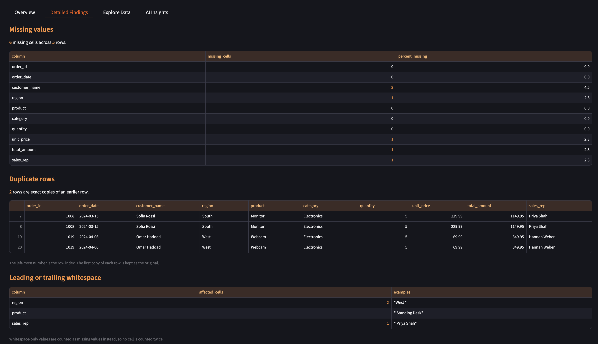
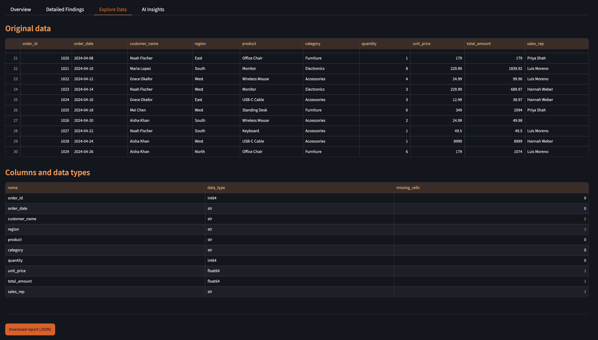

# AI Data Quality Checker

A Python and Streamlit application that identifies common data quality issues in CSV files, including missing values, duplicates, whitespace inconsistencies, and numerical outliers. It provides an interactive dashboard and optional AI-generated insights using Google Gemini.

### Overview Tab
Dashboard analyzing sample sales dataset, showing data metrics, missing values, duplicates, and possible outliers


### Detailed Findings Tab
A breakdown of missing values, duplicate records, and whitespace inconsistencies found in the dataset



### Explore Data Tab
View the original CSV records, column names, data types, and missing-value counts



### AI Insights Tab
Google gemini ai integration for explaining data findings and recommending next steps


## Features

- **CSV upload** of your own dataset (up to 10 MB), also a built-in sample sales dataset so you can try it without uploading anything
- **Missing values**: nulls, empty strings and whitespace-only text, counted per column
- **Duplicate rows**: exact copies of an earlier row
- **Whitespace issues**: text values with leading or trailing spaces
- **Numerical outliers**: possible anomalies found with the interquartile range (IQR) method

- **Dashboard**: summary metrics, a missing-values chart, detailed findings, and an Explore Data tab with original records and column data types.

- **Optional AI insights**: a summary, the impact, recommended next steps and priorities, using the Google Gemini API key.
- **JSON report download** with all findings, plus the AI insights if you generated them
- **Automated testing:** Includes pytest tests to verify data quality checks, CSV handling, and AI integration.

The app never changes or deletes your data. It only reports what it finds based on your CSV dataset.

## Tech stack

- Python 3.13
- pandas for the data checks
- Streamlit for the web interface
- Google Gen AI SDK (`google-genai`) for the optional Gemini AI insights
- python-dotenv for loading environment variables
- pytest for tests

## Getting started

These steps assume macOS or Linux and Python 3.13.

```bash
python3 -m venv .venv
source .venv/bin/activate
pip install -r requirements.txt
```

Run the app:

```bash
streamlit run app.py
```

Then open http://localhost:8501.

## Using the sample dataset

Click **Load Sample Dataset** to analyze 44 fictional sales records containing intentional data quality issues, including missing values, duplicate rows, whitespace inconsistencies, and numerical outliers. The application flags potential problems without modifying the original data.

## Optional: AI insights Tab

Using Gemini AI Insights on your dataset are optional. The application works without an API key.

To enable AI Insights:
1. Get a Gemini api key from Google AI Studio
2. Copy `.env.example` to `.env`
3. Add your API key to `GEMINI_API_KEY`
4. Restart the application